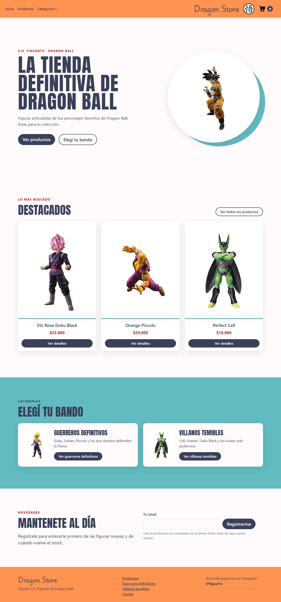

# Dragon Store

Tienda online de figuras S.H. Figuarts de Dragon Ball, hecha con React como proyecto final del curso de React de Coderhouse. Los productos y las órdenes viven en Firebase (Firestore).

Demo: https://proyectoreactcoda.netlify.app/



## Funcionalidades

- **Inicio** con hero, productos destacados, franja de categorías y registro de novedades. Las secciones aparecen con un fade a medida que bajás.
- **Catálogo** de productos que se lee desde Firestore, con estados de carga y error. Las cards también aparecen al hacer scroll.
- **Filtro por categoría** desde el menú: "Guerreros definitivos" (héroes) y "Villanos temibles".
- **Detalle de producto** con descripción, precio, stock disponible y selector de cantidad. Si el producto no existe, la página lo avisa.
- **Carrito** con contador en el navbar, aviso al agregar productos, tope por stock, eliminación de productos, vaciado y total.
- **Checkout** con nombre, teléfono y email: valida los campos, vuelve a leer precio y stock en Firestore, descuenta el stock y guarda la orden en la colección `buyers`.
- **Novedades**: formulario "Mantenete al día" que guarda los emails con Netlify Forms.
- **Página 404** para rutas que no existen.
- **Diseño responsive** con Bootstrap, adaptado a mobile (dos productos por fila en el teléfono).
- **Accesibilidad (WCAG 2.2 AA)**: un `<h1>` y un `<title>` por página, foco en el título al navegar, etiquetas accesibles, contraste AA, navegación completa con teclado y respeto por `prefers-reduced-motion`.

## Stack

- [React 18](https://react.dev/) + [Vite 6](https://vitejs.dev/)
- [React Router 7](https://reactrouter.com/) para la navegación
- [Firebase 13 / Firestore](https://firebase.google.com/) como base de datos
- [Bootstrap 5](https://getbootstrap.com/) (por CDN, con SRI) y CSS propio para los estilos, con tipografía Anton para los títulos
- `IntersectionObserver` nativo para el revelado al hacer scroll (sin librerías de animación)
- [SweetAlert2](https://sweetalert2.github.io/) para los avisos
- [Vitest](https://vitest.dev/) + [Testing Library](https://testing-library.com/) + [jest-axe](https://github.com/nickcolley/jest-axe) para los tests
- ESLint con `eslint-plugin-jsx-a11y` para el lint

## Cómo correrlo

Requisitos: Node.js 20 o superior.

1. Cloná el repo e instalá las dependencias:

   ```bash
   git clone https://github.com/Agustincoda/ProjectoReact.git
   cd ProjectoReact
   npm install
   ```

2. Copiá `.env.example` a `.env` y completá la config web de tu proyecto de Firebase (Consola de Firebase > Configuración del proyecto > Tus apps).

3. Levantá el servidor de desarrollo en http://localhost:5173:

   ```bash
   npm run dev
   ```

Otros scripts:

| Script | Qué hace |
| --- | --- |
| `npm test` | Corre los tests (checkout, carrito, novedades y validación de imágenes, con chequeo de accesibilidad) |
| `npm run build` | Genera la versión de producción en `dist/` |
| `npm run preview` | Sirve el build de producción localmente |
| `npm run lint` | Corre ESLint, incluidas las reglas de accesibilidad |

### Paleta

Los colores están como variables en `src/App.css` y Bootstrap los toma de ahí.

| Color | Hex | Uso |
| --- | --- | --- |
| Naranja | `#FF934F` | Navbar y footer |
| Índigo | `#3A405A` | Textos, títulos y botones |
| Snow | `#FFFBFC` | Fondo |
| Teal | `#62BBC1` | Franjas y detalles (no se usa para texto: no llega al contraste AA sobre fondo claro) |
| Caoba | `#BD1E1E` | Precios, etiquetas de sección y botón Eliminar |

### Datos en Firestore

La app espera dos colecciones:

- `Productos`: un documento por producto con los campos `Nombre`, `Descripcion`, `Precio`, `Stock`, `Imagen` (ruta dentro de `public/`, por ejemplo `/Images/GokuSHFiguart.jpg`, o una URL `https://`) y `Categoria` (`heroes` o `villanos`).
- `buyers`: la app crea acá una orden por cada compra, con el comprador, los productos, las cantidades, el total y la fecha.

### Deploy en Netlify

- `public/_redirects` hace que las rutas de la SPA (`/productos`, `/carrito`, etc.) funcionen al entrar directo o al recargar.
- `public/_headers` agrega los headers de seguridad: CSP (solo permite jsDelivr, Google Fonts y Firestore), HSTS, `frame-ancestors`, `Referrer-Policy` y `Permissions-Policy`. Si sumás otro servicio externo, hay que agregarlo a la CSP.
- Las variables `VITE_FIREBASE_*` de `.env.example` se cargan en Netlify en *Site configuration > Environment variables*, porque el `.env` no se sube al repo.
- `.nvmrc` fija Node 22 para el build.
- **Netlify Forms**: hay que activar la detección de formularios una vez en *Forms > Enable form detection* y volver a deployar. Netlify detecta el formulario oculto `novedades` de `index.html`, y los emails aparecen en *Forms > novedades*. En `localhost` el formulario muestra el mensaje de error porque Netlify Forms solo funciona en el sitio deployado.

### Seguridad

- La config web de Firebase es pública por diseño: termina en el bundle igual que cualquier variable `VITE_*`. Lo que protege los datos son las reglas de Firestore (ver mejoras pendientes).
- El build de producción no publica source maps.
- Las rutas de imagen que vienen de Firestore se validan: solo se aceptan rutas propias o `https://`.
- Dependabot revisa las dependencias npm cada semana. `npm audit` da 0 vulnerabilidades.

## Mejoras pendientes

- **Reglas de Firestore**: hoy cualquiera puede leer la colección `buyers` (con nombre, teléfono y email de los compradores), y el checkout escribe el stock desde el navegador, así que las reglas tienen que dejar que cualquiera modifique `Productos`. Lo correcto es cerrar la lectura de `buyers` y mover la confirmación de compra a una Cloud Function que valide stock y calcule el total del lado del servidor.
- **Checkout atómico**: el stock se revisa y después se descuenta en dos pasos; usar una transacción (`runTransaction`) evita vender de más si dos personas compran a la vez.
- **Persistir el carrito** en `localStorage` (solo IDs y cantidades) para que no se pierda al recargar la página.
- **Tests end-to-end** con Playwright: compra completa solo con teclado.
- **Fuentes propias**: servir la tipografía desde el sitio en vez de Google Fonts.
- **Código sin usar**: `itemListContainer.jsx`, `itemDetailContainer.jsx`, `item.jsx` y `src/assets/productos.json` son de una etapa anterior con datos locales.
- **Bundle de 870 kB**: se puede dividir con imports dinámicos por ruta.
